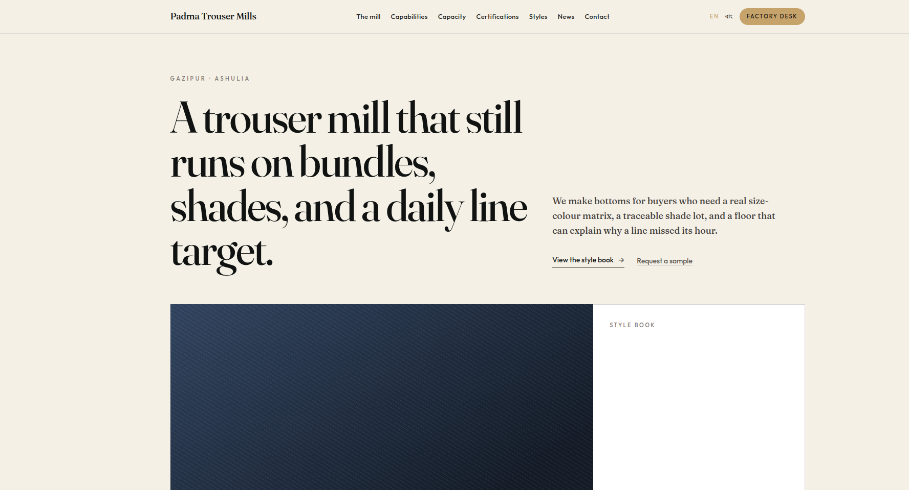
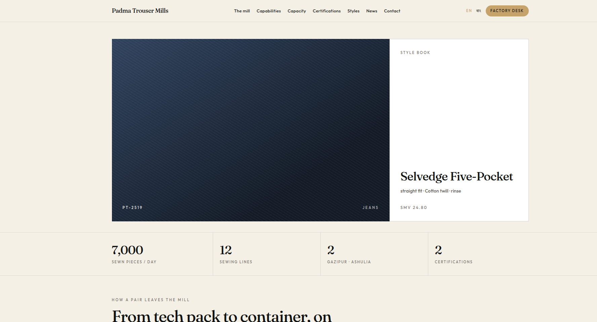
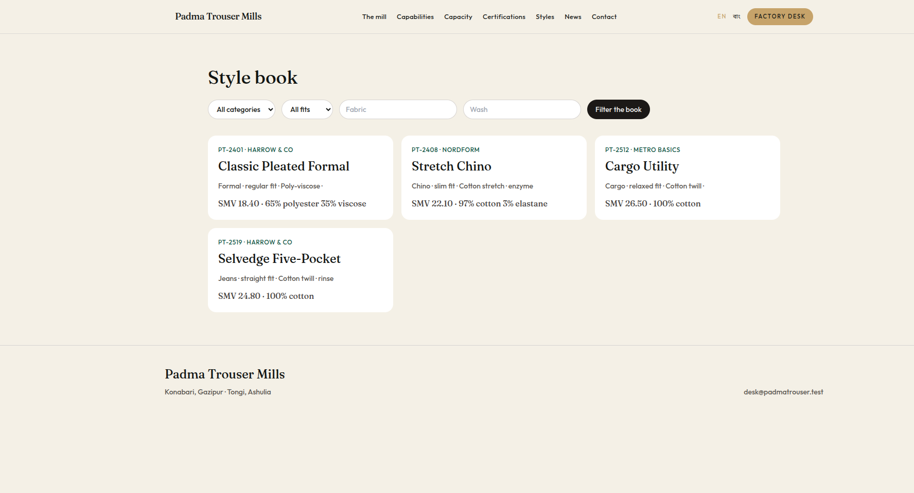
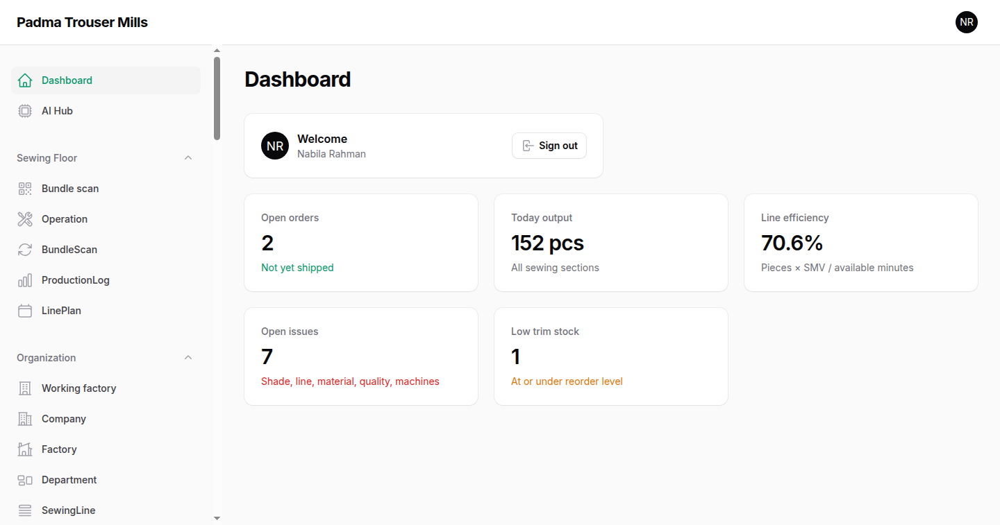
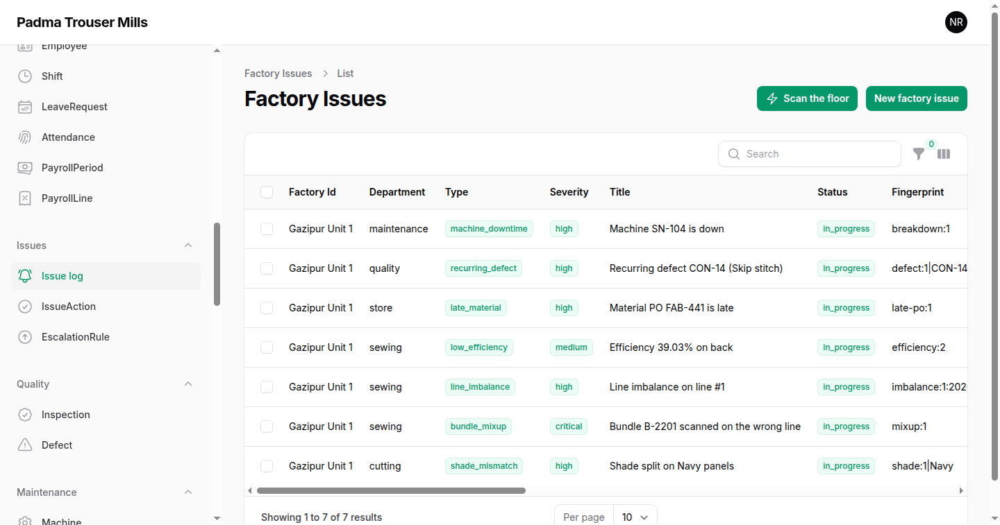
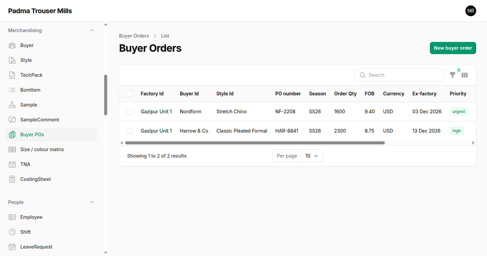

# Padma Trouser Mills

A digital twin of a trouser factory. Buyers see a style book. The floor sees bundles, shades, lines, and a desk that opens the corrective task before the morning meeting.

Gazipur and Ashulia are already loaded. Two buyer orders are in sewing. Seven problems that normally wait for a walk of the floor are already on the issue desk, with an owner and a next action.



The public site is English and Bengali. The factory desk is Filament. Every step that takes time in a real mill is a record someone can enter by hand, and the same record is what the detectors read.



## What this gives a mill

A 12-line trouser unit loses the morning to the same questions: which shade went to which line, which section is behind, which fabric PO slipped, which defect came back, which machine is down, and whose piece-rate matches yesterday’s punches. This desk answers those from the records the floor already keeps.

These are planning estimates for a unit the size of the demo (about 7,000 sewn pieces a day). They are the time a supervisor stops spending on discovery. They are not a measured customer case.

| The job | How it usually goes | What the desk does |
| --- | --- | --- |
| Shade band before a lay is issued | 30–45 minutes walking racks and comparing panels | Flags a colour the moment its bundles carry more than one shade |
| Line balance | Found at the end-of-day meeting, after the bottleneck has already starved assembly | Compares section output the same day. The demo back section is at 42 pieces while front is at 110 |
| Low efficiency | A clerk divides pieces by SMV after the shift | Uses `(pieces × SMV) / (operators × minutes)`. Anything under 70% opens an issue. The demo back section is at 39% |
| Late fabric | Sewing stops, then merchandising starts calling | The morning after a material PO misses its expected date. FAB-441 is already late |
| Repeat defect | The same skip stitch is written in three audit books | Groups one defect code. Three or more pieces in seven days gets a cause and a task. CON-14 skip stitch is already there |
| Bundle on the wrong line | Found when the colour does not match the loaded PO | A scan against today’s line plan. Bundle B-2201, a chino, was scanned onto the formal line |
| Machine downtime | A mechanic is called after the hour is already lost | An open breakdown, and a repeat pattern if the same head fails twice in 14 days. SN-104 is down |
| Piece-rate payroll | A day of matching attendance sheets to production sheets | One calculation on the payroll period: present days from punches, pieces from the production log |

The hourly command `factory:detect-issues --escalate` repeats the scan. Escalation rules with **auto-create task** turn each finding into owned work the moment it is detected. Issues that sit past their hour limit are acknowledged on the next pass.

## Who it is for

| Role | What they get |
| --- | --- |
| Owner / admin | Both factories, the executive numbers, audit log, and the switch-factory control |
| Merchandiser | Styles, tech packs, samples, buyer POs, size-colour matrix, TNA, costing, late material |
| Production manager | Line plans, bundle scans, efficiency, imbalance, machine downtime |
| Cutting master | Markers, lays, bundles, shade splits, cut-ticket PDFs |
| QC | Inline, end-line, and final audit, defects with a suggested cause |
| Store | Fabric rolls, trims, purchase orders, goods receipts, low-stock |
| HR | Shifts, leave, biometric or QR attendance, piece-rate plus attendance payroll |
| Buyer | Only their own styles and orders. The demo buyer is Harrow & Co |

## The buyer-facing site

English and Bengali, from the same pages.

- Homepage with capacity, the current style, and the path from tech pack to container
- The mill, capabilities, capacity, and certifications
- Style book filtered by category, fit, fabric, and wash
- Style page with the tech pack, construction notes, and a listing draft
- News, with a Bengali post and an English post
- Sample request, buyer inquiry, and factory tour, all landing in one merchandising queue



A buyer who is signed in only sees their own styles and orders. A guest sees the public book.

## The factory desk

Sign in at `/admin`. The seeded Gazipur floor looks like this.



Today’s board: **2 open orders**, **152 pieces** across sections, **70.6%** average efficiency, **7 open issues**, **1 trim** under its reorder level.



**Scan the floor** runs the detectors again. **Create tasks** turns the suggested actions on one issue into work for the role that owns it.



The pulse screen at `/hub` shows the same live counts and links into the admin, AI Hub, the catalog studio, document OCR, and blueprint studio.

## The flow, end to end

Every stage can be typed in. The detectors and the PDFs read the same tables.

### 1. Style and tech pack

Style number, season, buyer, category, fit, fabric, GSM, composition, SMV. Categories cover formal, casual, chino, jeans-style, and cargo. Fits run from skinny to comfort.

Tech packs are versioned: measurements, construction, artwork notes, approval. The bill of materials sits on the version, with consumption, unit of measure, cost, and supplier. Sample stages run Proto, Fit, Size Set, PP, with buyer comments on the sample.

With `FACTORY_AI=true`, AI Catalog drafts the public listing from the style. With it off, the mill still gets a local listing draft, which is what the demo uses.

### 2. Order and costing

A buyer PO is a size-colour matrix. Each cell keeps order quantity and the cut, sewn, and packed quantities as the order moves. Delivery date, priority, and status sit on the PO. TNA milestones have a planned date, an actual date, and an owner. The costing sheet holds SMV, CM, fabric, trim, wash, overhead, FOB, and margin.

The demo orders are Harrow formal `HAR-8841` (2,300 pieces, FOB 8.75) and Nordform chino `NF-2208` (1,600 pieces, FOB 9.40, urgent).

### 3. Fabric, trims, and the store

Suppliers, purchase orders, and goods receipts. A receipt can carry an OCR payload from a supplier invoice or packing list. Fabric is roll-wise: shade, lot, width, GSM, length, and what is left on the roll. Trims cover buttons, zippers, thread, interlining, labels, tags, polybags, and hangers, each with a reorder level. Stock movements and reservations tie material to an order.

Incoming QC on the receipt is pending, passed, failed, or conditional. The demo horn button is already under its reorder level, which is the low-trim number on the dashboard.

### 4. Planning and the cutting room

Sewing lines carry operator count, target efficiency, and an hourly target. A line plan is a date, an order, a quantity, and how many operators are allocated.

Markers store width, the size ratio, and marker efficiency. A cut plan is a lay: plies, shade, lot, and cut quantity. Bundles get a unique QR. Components (front, back, waistband, pocket, and the rest) are ticketed on the bundle, with their own shade, so a mixed panel can be stopped before assembly.

The cut ticket PDF is Bengali and English, from the lay.

### 5. Sewing floor

Sections are preparatory, front, back, and assembly. A bundle is scanned in or out at a section, on a line, by an operator. The floor-scan page warns when the bundle’s order is not the order loaded on that line today.

Production logs store target, actual, SMV, efficiency, and defects for the hour. Operator skill grade and piece rate sit on the employee. Efficiency on the dashboard is the garment formula, not a guess.

### 6. Quality

Inspections are inline, end-line, or final audit, with inspected, passed, and rejected quantities and an AQL level. Defects take a code, a category, a severity, and a photo. Categories cover shade, measurement, construction, stain, and trim. On save, the defect is given a root cause a QC can act on:

- Shade: panels from more than one lot
- Measurement: pattern, shrinkage, or the end-line spec
- Construction: needle, thread, and SPI before the next bundle
- Stain: oil or wash residue
- Trim: stop until the lot matches the tech pack

When the same code repeats, the issue desk groups it and assigns QC.

### 7. Wash, finishing, packing, shipment

Wash recipes hold the process, chemicals, temperature, and minutes. Wash lots track quantity and whether the lot is queued, running, or finished. Finishing batches track pressed and trimmed quantities.

Cartons carry colour, size, quantity, net and gross weight, and a barcode. A shipment is the mode, container, vessel, ETD, ETA, destination, and commercial invoice number.

Authenticated users download:

- `/documents/cut-tickets/{id}`
- `/documents/invoices/{id}`
- `/documents/packing-lists/{id}`

The PDFs are Unicode, so a Bengali line and an English line can sit on the same cut ticket, invoice, or packing list.

### 8. People, machines, and the clock

Shifts, leave, and employees. Attendance comes from the attendance hub: ZKTeco, eSSL, Hikvision, and the other drivers in that package, plus GPS and QR through the virtual driver. Punches land on `worker_attendance` by employee code. The hub’s own device log is left as the device log.

Payroll for a period is present days from check-ins, pieces from the production log, piece amount, and an attendance amount from the hourly rate.

Machines have a service date and a status. A breakdown records minutes down, the reason, and whether it is still open. Two breakdowns on one head inside 14 days is treated as a pattern, not a one-off.

Holidays are a local calendar. Fridays are non-working, which matches a Bangladesh mill. Dates on documents are formatted with Tarikh for English and Bengali.

### 9. Issue and automation engine

One log for every department. Detectors:

| Detector | What it watches |
| --- | --- |
| Shade mismatch | Bundles of one order and colour with more than one shade |
| Bundle mix-up | A scan today on a line whose plan is a different order |
| Line imbalance | Two sections on one line whose output differs by 1.25× or more |
| Low efficiency | A section under 70% with pieces on the board |
| Late material | A purchase order past its expected date and not received or closed |
| Recurring defect | One code reaching 3 pieces inside 7 days |
| Machine downtime | An open breakdown, and a head that fails twice in 14 days |

Thresholds live in `config/factory.php` and can be changed with `FACTORY_LOW_EFFICIENCY`, `FACTORY_IMBALANCE_RATIO`, and `FACTORY_RECURRING_DEFECTS`.

Each finding has suggested actions and a role. If an escalation rule for that type has **auto-create task**, those actions become tasks and the issue moves to in progress. Rules that only notify wait until `factory:detect-issues --escalate` and the hour limit have both passed.

With `FACTORY_AI=true`, AI Hub adds one short recommendation a floor manager can use today. If the model is down, the rule-based finding still stands.

## What you can turn on

Modules in `config/factory.php` can be set to `false`. The admin group hides. The tables stay, so turning a module back on does not require a migration.

| Flag | What it covers |
| --- | --- |
| `FACTORY_AI` | AI listing, OCR extraction, and the extra recommendation on an issue. Off by default, and the mill still runs |
| `FACTORY_AUDIT` | A row in the audit log for each create, update, and delete |
| `FACTORY_TIMEZONE` | Asia/Dhaka by default |
| `DRUTOGOTI_ENABLED` | Request and query timing. Events are queued so a page does not wait on the writer |
| `ADMIN_PANEL_PREFIX` | The pulse screen. Default `hub`, so Filament keeps `/admin` |

More than one company and more than one factory are in the schema. An admin with no factory selected sees all of them and can pin one from **Switch factory**. Every other role is pinned to the factory on their user.

## Run it

PHP 8.3 or newer, Composer, and a database. SQLite is the default. This project runs on Laravel 12, because the admin panel, Drutogoti, and the attendance hub constrain Illuminate to 11 or 12.

```bash
composer install
cp .env.example .env
php artisan key:generate
touch database/database.sqlite
php artisan migrate --seed
php artisan filament:assets
php artisan serve
```

`filament:assets` publishes the Filament CSS and JavaScript into `public/`. Without that step the desk has the records and none of the layout.

| | |
| --- | --- |
| Public site | http://127.0.0.1:8000 |
| Factory desk | http://127.0.0.1:8000/admin |
| Pulse | http://127.0.0.1:8000/hub |

Every demo account uses the password `password`.

| Email | Role |
| --- | --- |
| admin@trouser.test | Admin, both factories |
| merchandiser@trouser.test | Merchandiser, Gazipur |
| production@trouser.test | Production manager, Gazipur |
| cutting@trouser.test | Cutting master, Gazipur |
| qc@trouser.test | QC, Gazipur |
| store@trouser.test | Store, Gazipur |
| hr@trouser.test | HR, Gazipur |
| buyer@trouser.test | Buyer, Harrow & Co only |

Switch the public site with **EN** and **বাং** in the header.

### MySQL or PostgreSQL

In `.env`, set `DB_CONNECTION`, `DB_HOST`, `DB_PORT`, `DB_DATABASE`, `DB_USERNAME`, and `DB_PASSWORD`, then:

```bash
php artisan migrate:fresh --seed
```

### AI, OCR, and attendance hardware

Leave `FACTORY_AI=false` until a provider key is configured for AI Hub. OCR of a supplier invoice is available on the goods receipt; with AI off it stays in manual mode and stores nothing it did not read. Attendance hardware is configured through the attendance hub. The seeder uses the hub’s fake terminal so the demo has real punch rows for employee `101` without a device on the network.

Queue the performance watcher if you want those rows written:

```bash
php artisan queue:work
```

### Tests

```bash
php artisan test
```

The test run uses an in-memory database and turns AI, audit, and Drutogoti off. It checks the homepage, a sample request, the seven detectors, payroll lines, and that an admin can open the desk.

## Packages, and what each one actually does here

| Package | Where it shows up |
| --- | --- |
| Filament v3 | Every working module at `/admin` |
| laravel-admin-panel | The branded pulse at `/hub`, and navigation into the studios. Records, roles, files, and the audit log are the application’s, on top of Filament |
| laravel-ai-hub | Optional recommendation text on an issue |
| laravel-ai-ocr | Supplier invoices and packing lists on a goods receipt |
| laravel-ai-catalog | Optional style listing. The demo uses the local draft |
| laravel-attendance-hub | Biometric and GPS/QR punches, mapped onto employees by code |
| laravel-unicode-pdf | Cut ticket, commercial invoice, packing list |
| laravel-universal-slug | Public style and news URLs, including Bengali |
| drutogoti | Request and query timing when enabled |
| tarikh | English and Bengali dates. The package has no Laravel provider, so the app calls `Tarikh\Tarikh` directly |
| laravel-blueprint-studio | Installed from GitHub `dev-main`, because the Packagist tag points at a missing commit. Linked from the hub |
| laravel-filament-master | Module studio in the admin. A one-line alias in `app/Support/package_compat.php` points its file helper at the Filament v3 trait |

## What is in the box on the first seed

- Padma Trouser Mills, Gazipur Unit 1 (8 lines, 4,800 pieces) and Ashulia Unit 2 (4 lines, 2,200 pieces)
- Buyers Harrow & Co, Nordform, and Metro Basics
- Styles PT-2401 formal, PT-2408 stretch chino, PT-2512 cargo, PT-2519 selvedge five-pocket
- An approved tech pack, a BOM line, four operations, a PP sample with a buyer comment
- A size-colour matrix, a TNA with one delayed milestone, and a costing sheet
- Three fabric rolls on two shades, a low button stock, and a late khaki fabric PO
- Lay LAY-17, bundles including a shade B hold, and a chino bundle scanned onto line L1
- Front 110 and back 42 on the same line today
- Four skip-stitch defects, a wash lot, a finishing batch, a planned shipment with a carton
- Machine SN-104 broken down, escalation rules for all seven detectors, and the issues those rules already opened
- WRAP and OEKO-TEX, three Bangladesh holidays, an English post and a Bengali post
- A calculated payroll period for the current month

## Let's Connect & Collaborate

I am open to Senior Remote Full-Stack Roles, AI Platform Architecture Contracts, and Enterprise Technical Advisory.

**Timezone:** UTC+6 (Dhaka / Rangpur, Bangladesh) — Flexible overlap with US, UK, and European business hours.

**Delivery mode:** Async-ready, Slack, Discord, Jira, GitHub, and production-first accountability.

| | Channel | Address | |
| --- | --- | --- | --- |
| 🌐 | Primary Portfolio | [imrandev.bd](https://imrandev.bd) | [Visit Site](https://imrandev.bd) |
| 📦 | Packagist Packages | [packagist.org/packages/imrandevbd](https://packagist.org/packages/imrandevbd/) | [View Packages](https://packagist.org/packages/imrandevbd/) |
| 💼 | LinkedIn Profile | [linkedin.com/in/imranbru99](https://linkedin.com/in/imranbru99) | [Connect](https://linkedin.com/in/imranbru99) |
| 🐙 | GitHub Profile | [github.com/imranbru99](https://github.com/imranbru99) | [Follow](https://github.com/imranbru99) |
| 💬 | WhatsApp Direct | [+880 1576-918420](https://wa.me/8801576918420) | [Chat Now](https://wa.me/8801576918420) |
| 📧 | Direct Email | [me@imrandev.bd](mailto:me@imrandev.bd) | [Send Email](mailto:me@imrandev.bd) |
| 🐦 | X (Twitter) | [@imrandev_bd](https://x.com/imrandev_bd) | [Follow](https://x.com/imrandev_bd) |
| 📺 | YouTube Tech | [@ImranDevBD](https://youtube.com/@ImranDevBD) | [Subscribe](https://youtube.com/@ImranDevBD) |
